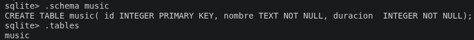

# ACTIVIDAD music.db

Tabla de canciones en music.db, id autoincrementar, nombre y duracion, rellenar con 10 canciones, duracion almacenada en seg.

```sql
CREATE TABLE music (
    id INTEGER PRIMARY KEY,
    nombre TEXT NOT NULL,
    duracion INTEGER NOT NULL
);
```

Para comprobar que la tabla ha sido creada escribimos en la terminal .schema music y .tables, en ambas deben aparecernos la tabla music.



Rellenar con 10 canciones, duracion almacenada en seg.

```sql

INSERT INTO music (nombre, duracion)
VALUES ("la bomba", 125 );

INSERT INTO music (nombre, duracion)
VALUES ("la gasolina", 200 );

INSERT INTO music (nombre, duracion)
VALUES ("dile", 160 );

INSERT INTO music (nombre, duracion)
VALUES ("ideales", 175 );

INSERT INTO music (nombre, duracion)
VALUES ("ciempies", 156 );

INSERT INTO music (nombre, duracion)
VALUES ("la caracola", 142 );

INSERT INTO music (nombre, duracion)
VALUES ("el arbol deprimido", 210 );

INSERT INTO music (nombre, duracion)
VALUES ("los lobos", 300 );

INSERT INTO music (nombre, duracion)
VALUES ("elefantes sobre la tela de una araña", 155 );

INSERT INTO music (nombre, duracion)
VALUES ("las bolas negras", 321 );

```

Si queremos comprobar si ha metido las 10 canciones, ponemos el comando siguiente, esperamos el resultado de 10.

```sql
SELECT COUNT(*) FROM music;
```

Modificar aquellas canciones que terminen por s y cambiamos la duracion en 10 min.

```sql
SELECT * FROM music WHERE duracion= 600;
```

Se nos quedaría algo así:
4|ideales|600
5|ciempies|600
8|los lobos|600
10|las bolas negras|600

Mostar aquellas canciones con una duracion >= 3 min.

```sql
SELECT * FROM music WHERE duracion>= 270;
```

Se nos quedaría algo así:
4|ideales|600
5|ciempies|600
8|los lobos|600
10|las bolas negras|600

En mi caso solo salen las de 10 min porque no hay ninguna otra que sea mayor a 270seg.

Buscar aquellas canciones que en nombre tengan la palabra "love".

```sql
UPDATE music
SET nombre='I love PDF'
WHERE nombre= 'la gasolina';
```

```sql
SELECT * FROM music WHERE nombre LIKE '%LOVE%';
```

Veremos algo así:
2|I love PDF|200

Contar el numero de canciones cuya duracion es mayor a 2 minutos y medio y dar la media de la duracion de las canciones.

```sql
SELECT COUNT(*) AS numero_canciones, AVG(duracion) FROM music WHERE duracion>150;
```

Se debería de ver algo así:
8|390.625
